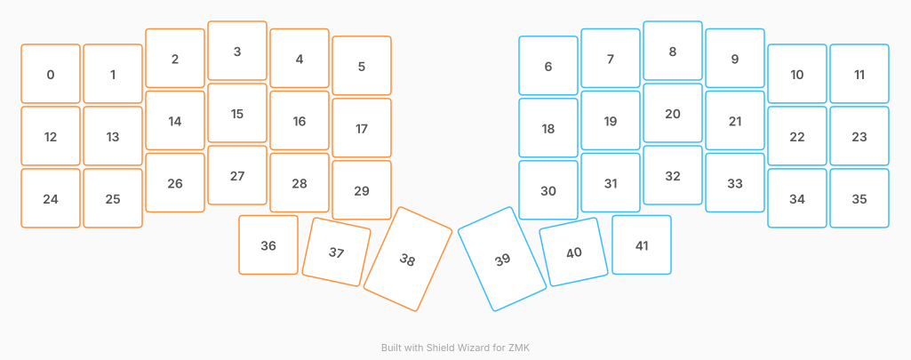

# ZMK Configuration for MEOWMEOWMEOW

*Generated by Shield Wizard for ZMK*



Download compiled firmware from the Actions tab. <https://zmk.dev/docs/user-setup#installing-the-firmware>

Edit your keymap <https://zmk.dev/docs/keymaps>.
User keymap is located at [`config/meowmeowmeow.keymap`](config/meowmeowmeow.keymap).

-----

<details>
<summary>
Shield Wizard Debug Information
</summary>

In case of broken configuration, here is the Shield Wizard internal data used to generate this configuration:

Commit: 6764e3d30a05e636ed273f525928b404e08565e9

```json
{"name":"MEOWMEOWMEOW","shield":"meowmeowmeow","dongle":false,"modules":[],"layout":[{"id":"01M6WE5EQGRVMTT5H4SSFJE8HE","part":0,"row":0,"col":0,"w":1,"h":1,"x":0,"y":0.37,"r":0,"rx":0,"ry":0},{"id":"01M6WE5EQG66QW8S6HDD1MYAM4","part":0,"row":0,"col":1,"w":1,"h":1,"x":1,"y":0.37,"r":0,"rx":0,"ry":0},{"id":"01M6WE5EQGK8KPVMN5R02X3ZE1","part":0,"row":0,"col":2,"w":1,"h":1,"x":2,"y":0.12,"r":0,"rx":0,"ry":0},{"id":"01M6WE5EQGY0Z3RZGC3RA763PD","part":0,"row":0,"col":3,"w":1,"h":1,"x":3,"y":0,"r":0,"rx":0,"ry":0},{"id":"01M6WE5EQGJXVWBPVNVSN3FMSW","part":0,"row":0,"col":4,"w":1,"h":1,"x":4,"y":0.12,"r":0,"rx":0,"ry":0},{"id":"01M6WE5EQG0WBZBQFW70J570K5","part":0,"row":0,"col":5,"w":1,"h":1,"x":5,"y":0.24,"r":0,"rx":0,"ry":0},{"id":"01M6WE5EQGRQB9K7Y5FBWV3QG9","part":1,"row":0,"col":6,"w":1,"h":1,"x":8,"y":0.24,"r":0,"rx":0,"ry":0},{"id":"01M6WE5EQGQF5CND4N1B366ZH4","part":1,"row":0,"col":7,"w":1,"h":1,"x":9,"y":0.12,"r":0,"rx":0,"ry":0},{"id":"01M6WE5EQGY3J7CEK23EMPJ9V0","part":1,"row":0,"col":8,"w":1,"h":1,"x":10,"y":0,"r":0,"rx":0,"ry":0},{"id":"01M6WE5EQGT6QNET4VEN1XE7SX","part":1,"row":0,"col":9,"w":1,"h":1,"x":11,"y":0.12,"r":0,"rx":0,"ry":0},{"id":"01M6WE5EQGDKK1CY2Y50XVH20Q","part":1,"row":0,"col":10,"w":1,"h":1,"x":12,"y":0.37,"r":0,"rx":0,"ry":0},{"id":"01M6WE5EQGE8K5ZETAMYC8B6H4","part":1,"row":0,"col":11,"w":1,"h":1,"x":13,"y":0.37,"r":0,"rx":0,"ry":0},{"id":"01M6WE5EQG3VXT7QW9MPDCPJG0","part":0,"row":1,"col":0,"w":1,"h":1,"x":0,"y":1.37,"r":0,"rx":0,"ry":0},{"id":"01M6WE5EQGF7GB7E0NK7YTGPD5","part":0,"row":1,"col":1,"w":1,"h":1,"x":1,"y":1.37,"r":0,"rx":0,"ry":0},{"id":"01M6WE5EQGX7PK9QBBHC1RAYWY","part":0,"row":1,"col":2,"w":1,"h":1,"x":2,"y":1.12,"r":0,"rx":0,"ry":0},{"id":"01M6WE5EQGC8891S0GTFEGNN9B","part":0,"row":1,"col":3,"w":1,"h":1,"x":3,"y":1,"r":0,"rx":0,"ry":0},{"id":"01M6WE5EQG2X890P5REF0M1QGT","part":0,"row":1,"col":4,"w":1,"h":1,"x":4,"y":1.12,"r":0,"rx":0,"ry":0},{"id":"01M6WE5EQGV9GQJHN3J80EXJGF","part":0,"row":1,"col":5,"w":1,"h":1,"x":5,"y":1.24,"r":0,"rx":0,"ry":0},{"id":"01M6WE5EQG2G1BCWPKFZXCD4GC","part":1,"row":1,"col":6,"w":1,"h":1,"x":8,"y":1.24,"r":0,"rx":0,"ry":0},{"id":"01M6WE5EQGA1JKRBRHWVN8EEX9","part":1,"row":1,"col":7,"w":1,"h":1,"x":9,"y":1.12,"r":0,"rx":0,"ry":0},{"id":"01M6WE5EQGEZVCG89ZKGF4CBSX","part":1,"row":1,"col":8,"w":1,"h":1,"x":10,"y":1,"r":0,"rx":0,"ry":0},{"id":"01M6WE5EQHTNJ0QN5D6EFERCGJ","part":1,"row":1,"col":9,"w":1,"h":1,"x":11,"y":1.12,"r":0,"rx":0,"ry":0},{"id":"01M6WE5EQHHFH1MBH5B667EEAQ","part":1,"row":1,"col":10,"w":1,"h":1,"x":12,"y":1.37,"r":0,"rx":0,"ry":0},{"id":"01M6WE5EQH1GXFRRPPEY87JHRQ","part":1,"row":1,"col":11,"w":1,"h":1,"x":13,"y":1.37,"r":0,"rx":0,"ry":0},{"id":"01M6WE5EQH43F3NEEQNXKB5R20","part":0,"row":2,"col":0,"w":1,"h":1,"x":0,"y":2.37,"r":0,"rx":0,"ry":0},{"id":"01M6WE5EQHRDXMFENWW4FKYGSC","part":0,"row":2,"col":1,"w":1,"h":1,"x":1,"y":2.37,"r":0,"rx":0,"ry":0},{"id":"01M6WE5EQHF60A5APDRD34E82E","part":0,"row":2,"col":2,"w":1,"h":1,"x":2,"y":2.12,"r":0,"rx":0,"ry":0},{"id":"01M6WE5EQHA06KB0GSVGM6SV9R","part":0,"row":2,"col":3,"w":1,"h":1,"x":3,"y":2,"r":0,"rx":0,"ry":0},{"id":"01M6WE5EQHXS1HHT5NNSNX1BAG","part":0,"row":2,"col":4,"w":1,"h":1,"x":4,"y":2.12,"r":0,"rx":0,"ry":0},{"id":"01M6WE5EQH7RY142V44VQ8Q5H2","part":0,"row":2,"col":5,"w":1,"h":1,"x":5,"y":2.24,"r":0,"rx":0,"ry":0},{"id":"01M6WE5EQHA4BT1Y5MWVK4Y4P8","part":1,"row":2,"col":6,"w":1,"h":1,"x":8,"y":2.24,"r":0,"rx":0,"ry":0},{"id":"01M6WE5EQH1FKW1TYT690D9YJ0","part":1,"row":2,"col":7,"w":1,"h":1,"x":9,"y":2.12,"r":0,"rx":0,"ry":0},{"id":"01M6WE5EQHVBM04VF3XGSD2NP5","part":1,"row":2,"col":8,"w":1,"h":1,"x":10,"y":2,"r":0,"rx":0,"ry":0},{"id":"01M6WE5EQHA2TX24F4395SS4Y0","part":1,"row":2,"col":9,"w":1,"h":1,"x":11,"y":2.12,"r":0,"rx":0,"ry":0},{"id":"01M6WE5EQHX9X3SDDTWHSKF4GY","part":1,"row":2,"col":10,"w":1,"h":1,"x":12,"y":2.37,"r":0,"rx":0,"ry":0},{"id":"01M6WE5EQHXWZTQR3BVAQH5Y9C","part":1,"row":2,"col":11,"w":1,"h":1,"x":13,"y":2.37,"r":0,"rx":0,"ry":0},{"id":"01M6WE5EQHEGF1A1SK1HM26CC0","part":0,"row":3,"col":3,"w":1,"h":1,"x":3.5,"y":3.12,"r":0,"rx":0,"ry":0},{"id":"01M6WE5EQH1E2RKAXQ7ZCZZQPE","part":0,"row":3,"col":4,"w":1,"h":1,"x":4.5,"y":3.12,"r":12,"rx":4.5,"ry":4.12},{"id":"01M6WE5EQH009ZYYSSC6DJ8FXS","part":0,"row":3,"col":5,"w":1,"h":1.5,"x":5.48,"y":2.83,"r":24,"rx":5.48,"ry":4.33},{"id":"01M6WE5EQHRAY56JDM3NT03C5Z","part":1,"row":3,"col":6,"w":1,"h":1.5,"x":7.52,"y":2.83,"r":-24,"rx":8.52,"ry":4.33},{"id":"01M6WE5EQHDQV7SXCPDWCNWW57","part":1,"row":3,"col":7,"w":1,"h":1,"x":8.5,"y":3.12,"r":-12,"rx":9.5,"ry":4.12},{"id":"01M6WE5EQH6TGDFHF9HR5RAFQF","part":1,"row":3,"col":8,"w":1,"h":1,"x":9.5,"y":3.12,"r":0,"rx":0,"ry":0}],"parts":[{"name":"left","controller":"nice_nano_v2","pins":{"d9":{"usage":"kscan","kscan":"01M6WEK08EFBRH45S6ZJPJ327S","role":"output"},"d8":{"usage":"kscan","kscan":"01M6WEK08EFBRH45S6ZJPJ327S","role":"output"},"d7":{"usage":"kscan","kscan":"01M6WEK08EFBRH45S6ZJPJ327S","role":"output"},"d6":{"usage":"kscan","kscan":"01M6WEK08EFBRH45S6ZJPJ327S","role":"output"},"d5":{"usage":"kscan","kscan":"01M6WEK08EFBRH45S6ZJPJ327S","role":"output"},"d4":{"usage":"kscan","kscan":"01M6WEK08EFBRH45S6ZJPJ327S","role":"output"},"d10":{"usage":"kscan","kscan":"01M6WEK08EFBRH45S6ZJPJ327S","role":"input"},"d16":{"usage":"kscan","kscan":"01M6WEK08EFBRH45S6ZJPJ327S","role":"input"},"d14":{"usage":"kscan","kscan":"01M6WEK08EFBRH45S6ZJPJ327S","role":"input"},"d15":{"usage":"kscan","kscan":"01M6WEK08EFBRH45S6ZJPJ327S","role":"input"}},"kscans":[{"kind":"matrix","id":"01M6WEK08EFBRH45S6ZJPJ327S","diodes":true}],"keys":{"01M6WE5EQG0WBZBQFW70J570K5":{"input":"d15","output":"d4"},"01M6WE5EQGJXVWBPVNVSN3FMSW":{"input":"d15","output":"d5"},"01M6WE5EQGY0Z3RZGC3RA763PD":{"input":"d15","output":"d6"},"01M6WE5EQGK8KPVMN5R02X3ZE1":{"input":"d15","output":"d7"},"01M6WE5EQG66QW8S6HDD1MYAM4":{"input":"d15","output":"d8"},"01M6WE5EQGRVMTT5H4SSFJE8HE":{"input":"d15","output":"d9"},"01M6WE5EQG3VXT7QW9MPDCPJG0":{"input":"d14","output":"d9"},"01M6WE5EQH43F3NEEQNXKB5R20":{"input":"d16","output":"d9"},"01M6WE5EQGF7GB7E0NK7YTGPD5":{"input":"d14","output":"d8"},"01M6WE5EQHRDXMFENWW4FKYGSC":{"input":"d16","output":"d8"},"01M6WE5EQHF60A5APDRD34E82E":{"input":"d16","output":"d7"},"01M6WE5EQGX7PK9QBBHC1RAYWY":{"input":"d14","output":"d7"},"01M6WE5EQGC8891S0GTFEGNN9B":{"input":"d14","output":"d6"},"01M6WE5EQG2X890P5REF0M1QGT":{"input":"d14","output":"d5"},"01M6WE5EQHXS1HHT5NNSNX1BAG":{"input":"d16","output":"d5"},"01M6WE5EQHA06KB0GSVGM6SV9R":{"input":"d16","output":"d6"},"01M6WE5EQH7RY142V44VQ8Q5H2":{"input":"d16","output":"d4"},"01M6WE5EQGV9GQJHN3J80EXJGF":{"input":"d14","output":"d4"},"01M6WE5EQHEGF1A1SK1HM26CC0":{"input":"d10","output":"d6"},"01M6WE5EQH1E2RKAXQ7ZCZZQPE":{"input":"d10","output":"d5"},"01M6WE5EQH009ZYYSSC6DJ8FXS":{"input":"d10","output":"d4"}},"encoders":[],"buses":{}},{"name":"right","controller":"nice_nano_v2","pins":{"d9":{"usage":"kscan","kscan":"01M6WECSFTPAA27FC68TA3JESQ","role":"input"},"d8":{"usage":"kscan","kscan":"01M6WECSFTPAA27FC68TA3JESQ","role":"input"},"d7":{"usage":"kscan","kscan":"01M6WECSFTPAA27FC68TA3JESQ","role":"input"},"d6":{"usage":"kscan","kscan":"01M6WECSFTPAA27FC68TA3JESQ","role":"input"},"d10":{"usage":"kscan","kscan":"01M6WECSFTPAA27FC68TA3JESQ","role":"output"},"d16":{"usage":"kscan","kscan":"01M6WECSFTPAA27FC68TA3JESQ","role":"output"},"d14":{"usage":"kscan","kscan":"01M6WECSFTPAA27FC68TA3JESQ","role":"output"},"d15":{"usage":"kscan","kscan":"01M6WECSFTPAA27FC68TA3JESQ","role":"output"},"d18":{"usage":"kscan","kscan":"01M6WECSFTPAA27FC68TA3JESQ","role":"output"},"d19":{"usage":"kscan","kscan":"01M6WECSFTPAA27FC68TA3JESQ","role":"output"}},"kscans":[{"kind":"matrix","id":"01M6WECSFTPAA27FC68TA3JESQ","diodes":true}],"keys":{"01M6WE5EQGRQB9K7Y5FBWV3QG9":{"input":"d6","output":"d10"},"01M6WE5EQGQF5CND4N1B366ZH4":{"input":"d6","output":"d16"},"01M6WE5EQGEZVCG89ZKGF4CBSX":{"input":"d7","output":"d14"},"01M6WE5EQGT6QNET4VEN1XE7SX":{"input":"d6","output":"d15"},"01M6WE5EQGDKK1CY2Y50XVH20Q":{"input":"d6","output":"d18"},"01M6WE5EQGE8K5ZETAMYC8B6H4":{"input":"d6","output":"d19"},"01M6WE5EQGY3J7CEK23EMPJ9V0":{"input":"d6","output":"d14"},"01M6WE5EQG2G1BCWPKFZXCD4GC":{"input":"d7","output":"d10"},"01M6WE5EQGA1JKRBRHWVN8EEX9":{"input":"d7","output":"d16"},"01M6WE5EQHTNJ0QN5D6EFERCGJ":{"input":"d7","output":"d15"},"01M6WE5EQHHFH1MBH5B667EEAQ":{"input":"d7","output":"d18"},"01M6WE5EQH1GXFRRPPEY87JHRQ":{"input":"d7","output":"d19"},"01M6WE5EQHA4BT1Y5MWVK4Y4P8":{"input":"d8","output":"d10"},"01M6WE5EQH1FKW1TYT690D9YJ0":{"input":"d8","output":"d16"},"01M6WE5EQHVBM04VF3XGSD2NP5":{"input":"d8","output":"d14"},"01M6WE5EQHA2TX24F4395SS4Y0":{"input":"d8","output":"d15"},"01M6WE5EQHX9X3SDDTWHSKF4GY":{"input":"d8","output":"d18"},"01M6WE5EQHXWZTQR3BVAQH5Y9C":{"input":"d8","output":"d19"},"01M6WE5EQHRAY56JDM3NT03C5Z":{"input":"d9","output":"d10"},"01M6WE5EQHDQV7SXCPDWCNWW57":{"input":"d9","output":"d16"},"01M6WE5EQH6TGDFHF9HR5RAFQF":{"input":"d9","output":"d14"}},"encoders":[],"buses":{}}]}
```

</details>
